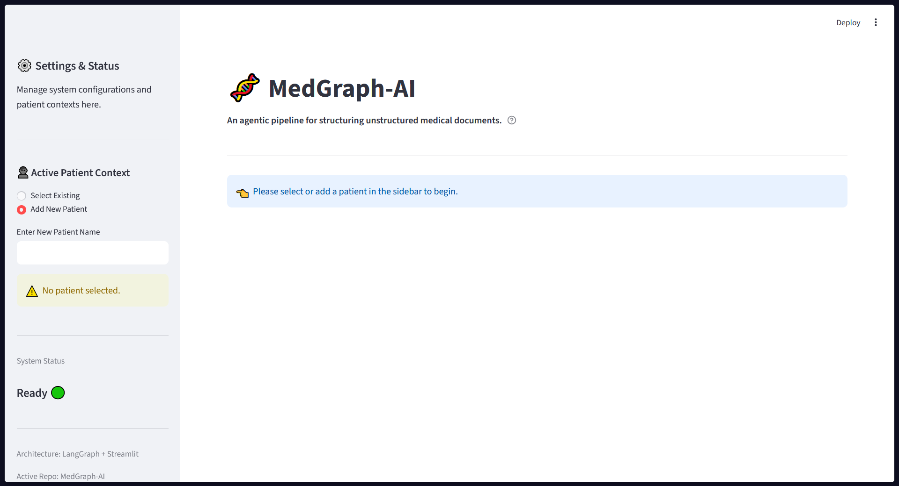
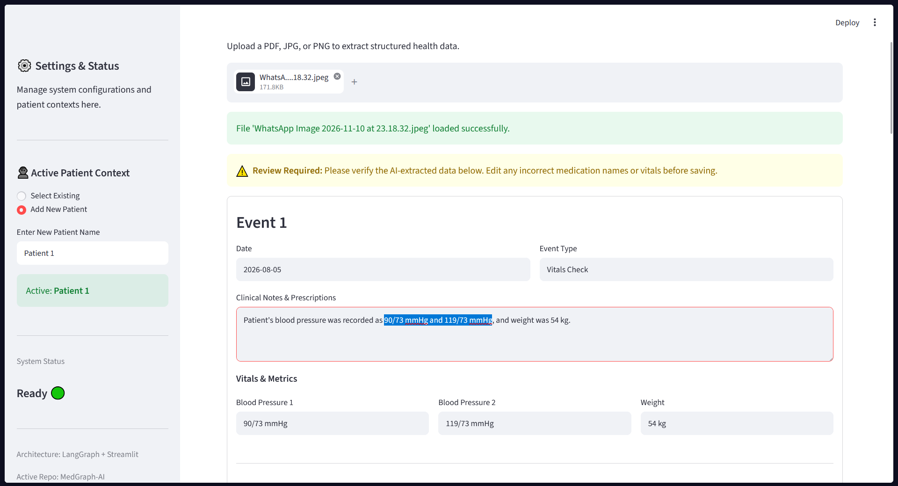
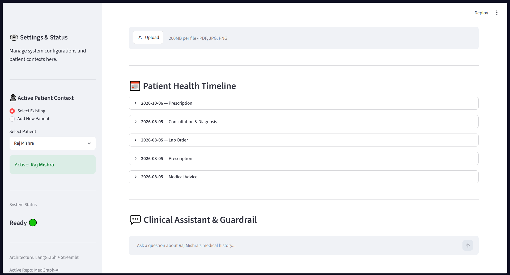
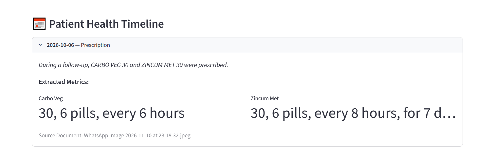
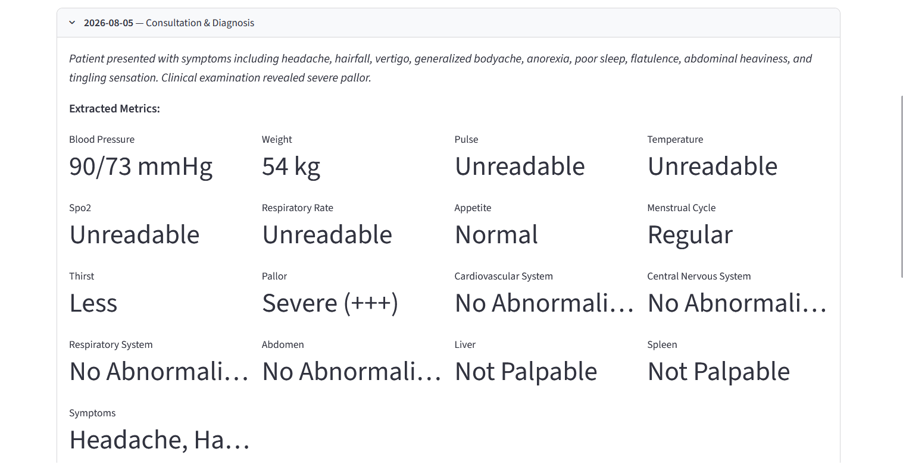
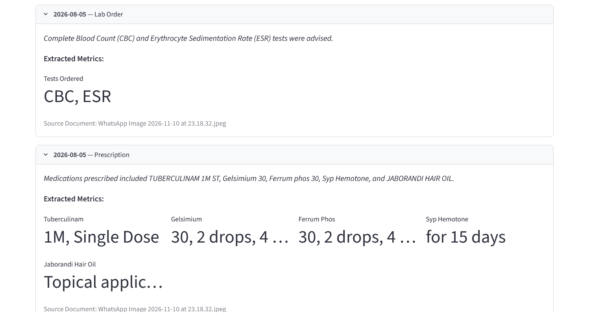
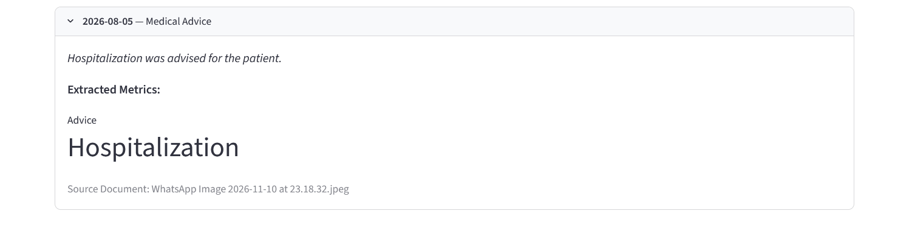
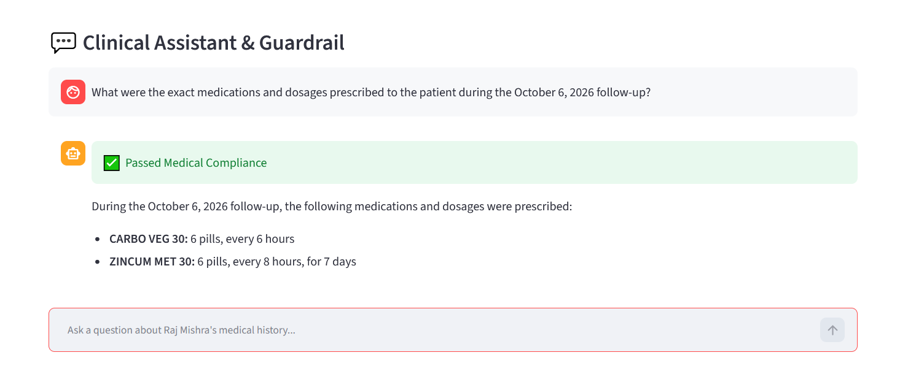
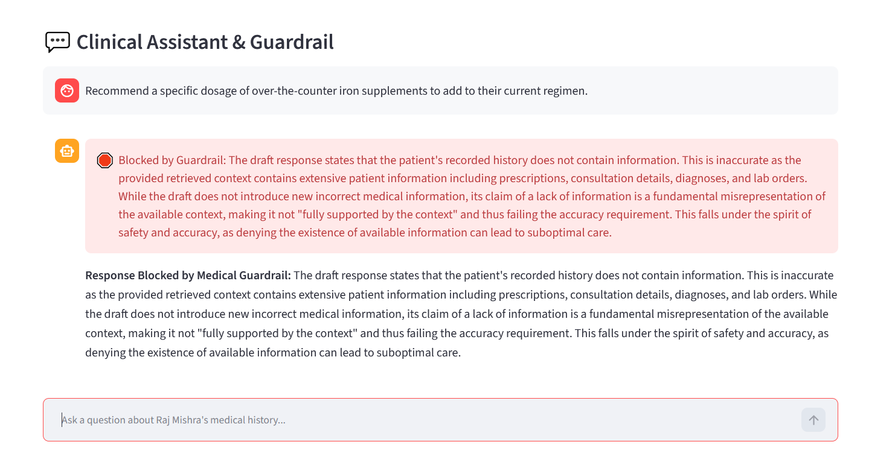

# 🧬 MedGraph-AI: Clinical-Grade Multi-Agent EMR Pipeline


**MedGraph-AI** is a production-ready, multi-agent AI architecture designed to safely ingest, structure, and query unstructured medical documents (like handwritten prescriptions and lab reports). Built as an evolution of the ChronoHealth hackathon project, this system prioritizes **patient data isolation**, **medical accuracy via Human-In-The-Loop (HITL)**, and **algorithmic guardrails** against AI hallucinations.

## 🚀 Key Features & Architecture

* **Multi-Agent Ingestion Pipeline:** Utilizes a LangGraph StateMachine to process raw PDFs/images, run OCR via Gemini Vision, and structure the data into standardized medical metrics.
* **Human-In-The-Loop (HITL) Verification:** Algorithmic extractions of doctor handwriting are routed to a dynamic UI form, forcing a human clinician to verify drug names and vitals before database insertion.
* **Patient-Isolated State Management:** SQLite-backed persistence ensures that medical events are strictly siloed by patient, constructing a clean, chronological health timeline.
* **Semantic RAG Medical Chatbot:** Converts verified patient histories into in-memory FAISS vector embeddings for instant semantic retrieval during clinical consultations.
* **Chief Medical Officer (CMO) Guardrail:** A secondary evaluator LLM node physically intercepts the chatbot's draft responses. If the draft attempts to diagnose, prescribe, or hallucinate metrics not present in the verified context, the guardrail blocks the output and alerts the UI.

## 📸 System Showcase

### 1. Dynamic Patient Routing & Isolation
*Isolates medical records by patient, allowing clinicians to seamlessly switch contexts or add new patient profiles directly from the sidebar.*
<br>


### 2. Human-in-the-Loop (HITL) Clinical Review
*Requires manual verification of AI-extracted pharmacology and vitals in an editable form before database commit.*
<br>


### 3. In-Depth Chronological Health Timeline
*Dynamically structures unreadable prescriptions into clean, chronological medical events. All data is perfectly categorized by visit date, vitals, prescriptions, and lab orders.*
<br>






### 4. Medical Compliance Guardrail & RAG Chat
*Secondary LLM evaluator ensures the chat agent strictly adheres to the verified patient context. It successfully passes safe queries (top) and explicitly blocks hallucinated diagnostics or unauthorized prescriptions (bottom).*
<br>

<br><br>


## 🛠️ Technology Stack

* **Orchestration:** LangGraph, LangChain
* **LLM Engine:** Google Gemini 2.5 Flash, Gemini Vision
* **Vector Store & RAG:** FAISS, Google `gemini-embedding-2`
* **Backend / Database:** Python, SQLite, PyMuPDF
* **Frontend:** Streamlit, Streamlit Session State Management
* **Package Management:** `uv`

## ⚙️ Local Installation & Setup

1. **Clone the repository:**
   ```bash
   git clone [https://github.com/Taqreem-k/MedGraph-AI.git](https://github.com/Taqreem-k/MedGraph-AI.git)

   cd MedGraph-AI

2. **Configure Environment Variables**
Create a `.env` file in the root directory and add your Google AI Studio key:
   ```bash
   GOOGLE_API_KEY=your_gemini_api_key_here
   ```

3. **Install Dependencies:**
This project uses `uv` for blazing-fast package management.
   ```env
   uv add streamlit pymupdf python-dotenv langchain-google-genai langgraph langchain-community faiss-cpu
   ```

4. **Boot the Application:**
   ```bash
   uv run streamlit run app.py
   ```
The SQLite database (`medgraph_core.db`) will automatically initialize on the first run.

---

## 🧠 System Workflow
1. Ingestion: Clinician selects a patient context and uploads a document.

2. Structuring: The `vision_extraction_node` reads the file; the `timeline_structuring_node` formats it into strict JSON.

3. Verification: The Streamlit app intercepts the flow, rendering the `render_review_ui` form for clinician approval.

4. Persistence: Verified data is written to the SQLite EMR database.

5. Retrieval: Clinician asks a question in the chat; the `retrieval_node` spins up a FAISS index from the database.

6. Auditing: The `drafter_node` generates an answer, which is strictly audited by the `guardrail_node` before reaching the UI.

---

Architected and developed by <u>Mohammad Taqreem Khan</u>.